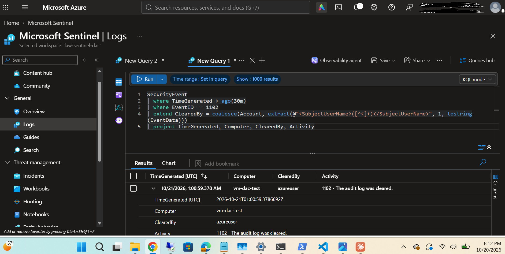
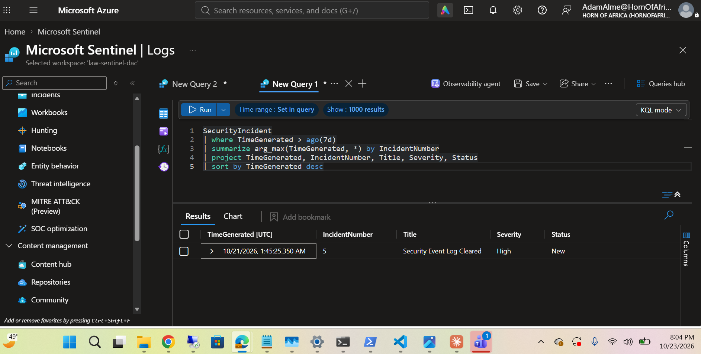
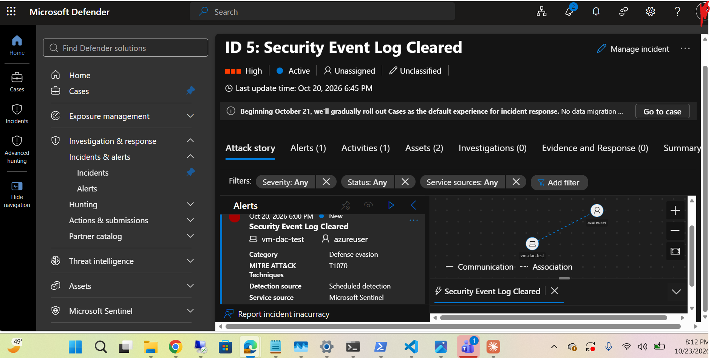
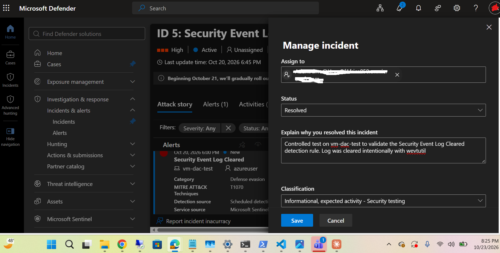

# Rule 2 Validation: Security Event Log Cleared

## Summary
| Field | Value |
|---|---|
| Rule | Security Event Log Cleared |
| Severity | High |
| MITRE ATT&CK | Defense Evasion – T1070.001 (Clear Windows Event Logs) |
| Data source | SecurityEvent, Event ID 1102 (via AMA + DCR) |
| Deployed with | Terraform (`rules.tf`) |
| Result | ✅ Passed: incident created and triaged |

## Why this rule matters
Attackers clear the Windows Security log to hide their activity. Windows still writes one final event (1102) recording that the log was cleared, which makes it a reliable tripwire.

## Test performed
- **Date:** 2026-10-21 01:00:59 UTC
- **Host:** vm-dac-test (isolated test VM in my own Azure tenant)
- **Action:** Ran `wevtutil cl Security` as administrator
- **Expected:** Event 1102 in Sentinel → rule fires within 1 hour → High incident

## Detection logic
```kql
SecurityEvent
| where EventID == 1102
| extend ClearedBy = coalesce(Account, extract(@"<SubjectUserName>([^<]+)</SubjectUserName>", 1, tostring(EventData)))
| project TimeGenerated, Computer, ClearedBy, Activity
```

**Engineering note:** For Event 1102 the `Account` column is empty. The user who cleared the log is stored inside `EventData`, so I extracted `SubjectUserName` into a `ClearedBy` column and mapped it to the Account entity.

## Results
- Event 1102 arrived in Sentinel: Computer = vm-dac-test, ClearedBy = azureuser
- Incident #5 created at 2026-10-21 01:45:25 UTC: "Security Event Log Cleared" (High)
- Time from event to incident: ~44 minutes (rule runs hourly)
- Entities mapped in the incident graph: Host → vm-dac-test, Account → azureuser
- Triaged in the Microsoft Defender portal: assigned, resolved as Benign Positive (Informational, expected activity – Security testing)

## Evidence






## Lessons learned
- Not every Windows event fills the standard `Account` column; check `EventData` when a field is empty.
- Sentinel incidents are now managed in the unified Microsoft Defender portal.
- Entity mapping turns an alert into an investigation graph showing who did what, where.